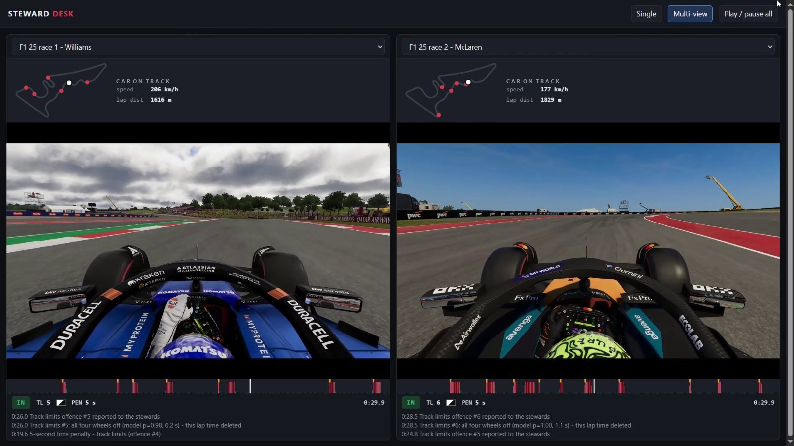
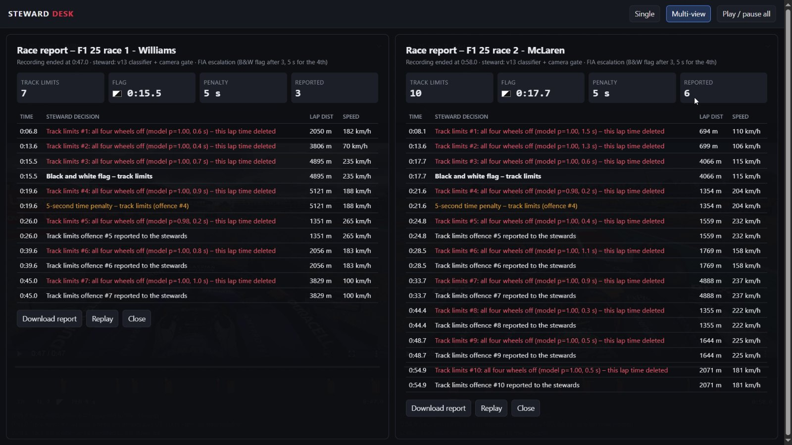

# Digital Stewards

Track limits are one of the most argued-about calls in Formula 1. A lap gets deleted, a driver gets the
black-and-white flag, and everyone asks the same question: were all four wheels really off?

Digital Stewards answers that question from the only thing everyone has: the onboard video. It watches the
camera feed frame by frame, decides whether the car is still on the track, and turns those decisions into a
steward's log with FIA-style penalties, live, as the footage plays.



---

## What it does

- **Judges every frame.** A small image classifier looks at the road around the front tyres and says IN or OUT.
- **Knows when it can't judge.** Broadcast onboards cut to rear-facing, halo and close-up cameras. A camera
  gate spots those and gives *no verdict* instead of guessing.
- **Thinks like a steward.** Single-frame blips don't count. Two touches of the same corner are one offence.
  Every offence deletes the lap time, the third brings the black-and-white flag, and the fourth is a 5-second
  penalty, the same escalation the FIA uses in races.
- **Shows it all in one place.** *Steward Desk* is a small web dashboard: the onboard on the left, the live
  decision log on the right, several cars side by side, and a race report when each recording ends.

## The rule we judge by

FIA International Sporting Code, Appendix L: the white lines belong to the track, the kerbs do not, and a driver
has left the track when no part of the car is still in contact with it. In practice: **OUT means all four
tyres are completely beyond the outer edge of the white line.** If one tyre is still touching the line, it's IN,
however wide the rest of the car is. Every label in this project follows that rule.

---

## The final model (v13)

| | |
|---|---|
| Architecture | YOLOv8s-cls image classifier, 5.1 M parameters, 10 MB (`models/digital_steward_v13.pt`) |
| Input | 448 x 448 square crop of the road strip ahead of and beside the front tyres (rows 22-68% of the frame for game cameras, 12-72% of the picture for F1 TV onboards) |
| Output | p(OUT); OUT when p >= 0.5 |
| Training images | 36,915 (24,675 IN / 12,240 OUT), of which 19,674 are original frames and the rest degraded copies |
| Validation | 2,468 held-out frames, top-1 accuracy 99.4% |
| Training run | 30 epochs, batch 32, SGD (auto), lr 0.01, about 2 hours on one RTX 3060 (12 GB) |
| Speed at use | about 7x faster than real time on the same GPU, 10 frames per second analysed |

### How it was trained

The model went through thirteen versions. Each one was tested on footage it had never seen, every wrong call
was looked at by eye, and the lessons went into the next version. The things that mattered most:

1. **Look where the tyres are.** Early versions saw a wide strip that the trainer centre-cropped, so they never
   actually saw the front tyres. Squashing the whole strip into a square (and turning off random crops) fixed that.
2. **Near misses are the real training data.** Clean laps are easy. The hard part is a car riding the kerb with
   one tyre still on the line. Thousands of these legal close calls were added as IN, and so were "legal
   straddles", where three wheels are over and one is not.
3. **No left/right flips.** Which side of the car the white line is on matters, so mirroring images is turned off.
4. **Make the game look like TV.** Clean game frames got degraded copies: colour shifts, lower resolution,
   motion blur, sensor noise and heavy JPEG, so the model doesn't depend on a pristine picture.
5. **Real footage, at the end.** The last two versions added real F1 onboards (FIA-confirmed excursions only).
   Every real OUT frame was used ten times (once clean, nine degraded), because real excursions are rare.
6. **Training stability.** Mixed precision went NaN on this data, so it's off. A small guard repairs the
   BatchNorm statistics if a single bad batch corrupts them.

Effort, roughly: about 2.5 hours of our own driving footage for training, about 3 hours of real F1 onboards, thirteen
training runs of 1-2 hours each, and every excursion in the training data looked at by eye.

---

## The data

None of the footage is in this repository (see [Data and footage](#data-and-footage)), but this is how it was built.

### 1. F1 25 footage we drove ourselves

All at the Circuit of the Americas, recorded with screen capture while we drove: about two and a half hours
over seven sessions for training, plus separate sessions kept back for testing.

- **Cars:** McLaren, Red Bull, Ferrari, Mercedes, Aston Martin, Racing Bulls (the Williams in the screenshots is from a later demo session).
- **Cameras:** the T-cam, the low "TV pod" camera, and a camera behind the helmet (the one most real onboards use).
- **Conditions:** dry and wet, midday and sunset, HUD on and off.
- **Driving:** clean laps, laps hugging the left line, laps hugging the right line, deliberate excursions at
  every corner, kerb riding, and lots of near misses.

Excursions were found by checking the footage against a track-limits map of COTA built from a 3D model of the
circuit. Then **every OUT moment was checked by eye** at full resolution, both front tyres and the white line,
using the rule above. Anything that couldn't be confirmed was left out instead of guessed. That check caught
real mistakes: 35 "OUT" moments turned out to have one tyre still on the tarmac and were corrected to IN.

### 2. Other people's onboards (valid laps)

Whole F1 25 races uploaded by other players, world-record hotlaps, and real pole-lap onboards (2021, 2023 and
2026 US Grands Prix). These laps were valid, so they teach the model what normal, legal driving looks like
across different cars, cameras and video quality. About 4,800 IN frames.

### 3. Real F1 onboards (F1 TV)

Real excursions are what the model needs most, and they are rare, so they were collected one by one:

1. Start from the **FIA race-control documents** for the 2025 and 2026 United States Grands Prix, the official
   list of every lap deleted for track limits (`data/fia/`).
2. Play the F1 TV replay of each listed driver and record the onboard.
3. Read the player clock and the selected driver straight from the screen, so every frame has a time and a name.
4. Find each deletion in the footage and **zoom in on the tyres at full resolution**. If all four wheels are
   visibly off, it's OUT. If the onboard can't prove it (for example, the inside front tyre is still on the
   line and the rear is out of view), it's *unsure* and left out of training.

Our labels for every real session are in `data/labels/` (times only, no footage). Training used 266 confirmed
real OUT frames and about 5,400 real IN frames from the 2026 race and the 2025 sprint and qualifying.

---

## Results

Everything below is footage the model never trained on.

### Game footage

| Test | Result |
|---|---|
| Our own race (T-cam, whole session held out) | 51 of 51 excursions caught (train + test splits) |
| Low camera, held-out laps | 12 of 12 excursions, 100% of OUT frames, every clean frame right |
| Helmet camera, held-out laps | 14 of 14 excursions |
| Other players' valid laps (world-record hotlaps, YouTube races) | 0.0-0.6% of frames wrongly called OUT |

### Real Formula 1

**2026 United States GP: drivers held out of training (Hadjar, Leclerc and five others).**
All 3 confirmed excursions caught, every OUT frame right (111/111), and no false OUT on 1,019 clean frames.

**2025 United States GP: Lando Norris's full race onboard.** The whole race was kept out of training and used
as one long, honest test: about 85 minutes of real broadcast onboard, with the director cutting between cameras.

- **No false offences** in the whole race.
- The camera gate correctly skipped every switch to the rear, halo and close-up cameras.
- **Against the FIA's own record:** the FIA deleted three of Norris's laps (lap 13 Turn 20, lap 15 Turn 9, lap
  19 Turn 13) and showed him the black-and-white flag. Digital Stewards called the first two at the exact
  moments. It missed lap 19 Turn 13. In that onboard the right-front tyre stays on the tarmac the whole time,
  so whatever the stewards saw (probably the rear wheels) isn't visible from this camera.



---

## Steward Desk

A local web dashboard (it runs on your machine, nothing is uploaded).

- **Left:** the recording, with an IN / OUT / NO VERDICT badge and a timeline of the model's confidence.
  Click anywhere on the timeline to jump there.
- **Right:** the live steward log. Offences, the black-and-white flag and penalties appear as playback reaches them.
- **Multi-view:** up to four recordings side by side, with one button to play them all.
- **Race report:** when a recording ends, a report pops up with every decision, its time, lap distance and speed.
  It can be downloaded as text.
- Recordings cut from several pieces of footage keep their cuts, so two moments that only look close because
  of an edit are never merged into one offence.

---

## Getting started

```bash
pip install -e .            # Python 3.10+, a CUDA GPU recommended
```

**Judge a video from the command line**

```bash
digital-stewards scan my_onboard.mp4 --weights models/digital_steward_v13.pt --out scan.csv
# --rows 0.12,0.72 for a broadcast-style onboard (default 0.22,0.68 fits F1 25 cameras)
```

**Open Steward Desk**

```bash
digital-stewards dashboard add my_onboard.mp4 --name "My race" --profile game
digital-stewards dashboard serve           # then open http://127.0.0.1:8765
```

Profiles: `game` (F1 25, full frame), `f1tv` (F1 TV player in a browser window), `full` (any full-frame onboard).
Big or `.mkv` files get a 720p viewing copy automatically, because browsers won't play them. The analysis
always uses the original.

**Penalty rules** live in `configs/penalties.yaml`. The default is the FIA's race escalation. Want "three strikes
and it's five seconds"? Change one line.

**Train your own**

```bash
digital-stewards train --data datasets/my_dataset      # folders: train/{in,out}, val/{in,out}
digital-stewards eval  --data datasets/my_dataset --weights runs/train/train/weights/best.pt
```

`tools/` has what we used for real footage: reading the F1 TV clock (`f1tv_ocr_blocks.py`), building
labelled frames from a label file (`f1tv_build.py`), zoom sheets for checking tyres by eye (`f1tv_zoom.py`),
merging datasets with degraded copies (`merge_datasets.py`) and fixing screen captures that dropped frames
(`to_constant_fps.py`).

## Repository layout

```
models/        the final model + its training record (curves, confusion matrix, settings)
src/digital_stewards/
  classifier.py   crop, train, evaluate, scan
  camgate.py      "is this the onboard camera?"
  penalties.py    steward rules: offences, black-and-white flag, penalties
  augment.py      broadcast-style degradation for training copies
  dashboard/      Steward Desk (server, background analysis, web page)
configs/       penalty rules
data/fia/      FIA deleted-lap lists (2025 and 2026 US GP)
data/labels/   our labels for the real onboards (times only)
tools/         real-footage and dataset tools
tests/         unit tests (pytest)
docs/          screenshots
```

## Limitations

- **One circuit.** Everything so far is the Circuit of the Americas. Other tracks have different kerbs, paint
  and run-off, and need their own data.
- **The camera decides what can be proven.** If the decisive tyre is out of view, the model can't see it. Some
  FIA deletions (often the rear wheels at the exit of a corner) can't be confirmed from a forward onboard.
- **Legal straddles are the hardest case.** Three wheels over and one still on the line is legal, but about one
  in five of those frames is still called OUT. The 0.2-second minimum hides most of this, not all.
- **It's a second opinion, not a steward.** It's built to show its working, not to replace the people in the
  stewards' room.

## Data and footage

Not included, on purpose:

- **F1 TV footage** belongs to Formula 1. We recorded it from our own subscription for research and testing
  only. Only our time labels and the FIA's public documents are shared here.
- **Game footage and image datasets** are many gigabytes. The model was trained on them, and the methods are
  described above.

## Disclaimer

An independent project. Not affiliated with, endorsed by or connected to the FIA, Formula 1, F1 TV, EA Sports or
Codemasters. "F1", "Formula 1" and related marks belong to their owners. F1 25 is a game by EA Sports /
Codemasters.
